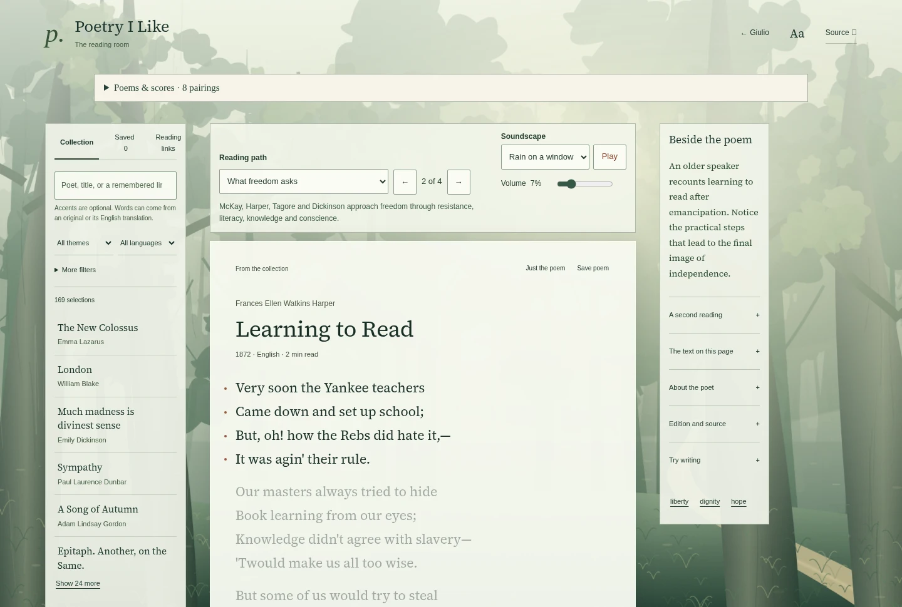

# Poetry I Like

A browser reading room with **167 complete poems by 134 poets**, including 10
Italian, 11 French and 10 Polish originals. All 31 have attributed English translations. Nine modern
favourites link to readable editions. They are counted separately from poems.

Search a remembered line, choose a language or theme, save a poem, or read a
shuffled shelf without repeats. Original, English and side-by-side views keep
the source text close to each translation. Eight guided paths sit above the poem,
with previous and next controls and a position indicator.

## Run locally

Node.js 20 or later. No package dependencies or API keys.

```sh
git clone --branch codex/poetry-paths-and-rain https://github.com/sargonxg/Poetry-I-Like.git
cd Poetry-I-Like
npm test
npm run dev
```

Open http://127.0.0.1:5175. `npm run build` creates a self-contained
`dist/index.html`, including the collection, Source Serif 4, illustration and
reader. It also opens directly as a local file. External edition links need an
internet connection. Choose Light rain, Woodland rain, Rain on a window or
Stream above a poem. The three rain recordings load after you start sound.
The single-file reader uses local sound textures when recordings cannot load.

## Read and return

The library starts with complete poems. Reading links have a separate shelf.
Search works across titles, poets and original lines; language and theme
filters combine. The random shelf visits every selection before reshuffling.

Save poems in this browser. Export/import a shelf of IDs, share a poem or line
bookmark, copy a source citation, print, or download a private note. Notes remain
in the tab and clear when switching poems; download a note before leaving it.

Reading settings offer size, spacing, line focus, plain paper and sound. No
account, analytics, model endpoint or reading history leaves the browser. The
rain recordings crossfade when you change sound and stop when the tab is hidden.
A volume slider sits beside the rain selector. Choose line or stanza focus
in the reading settings, then use the arrow keys within the poem. Path links
retain the selection and the current poem. Sleep timer and [recording credits](assets/ambience/provenance.json) are
in the reading settings.

## Sources, translations and audit

`data/poems.json` is the canonical collection. Each full text carries an edition,
rights basis and source check. `data/source-audit-20261112.json` documents
source-text verification, excerpt corrections and held records. Broken compound
PoetryDB URLs were replaced with verified title endpoints. Three edition
variants were replaced with the exact source text; Giusti's Sant'Ambrogio is
now the complete 96-line poem. The ten additions are checked against the
Academy of American Poets, PoetryDB or Wikisource, with links and rights
information on each record.

Full texts use public-domain originals. PoetryDB collection data is CC BY 4.0;
original texts and translations have distinct rights. Modern favourites such as
Krynicki, Montale and Sbarbaro remain external references with no protected verse
stored. Book listings, lectures and unavailable links are excluded from that
shelf. [Concordia Discors](https://concordiadiscors.org/poetry/) provides reading
inspiration; a collection listing does not count as a complete poem.

New English translations are **AI-generated for this project** and labelled in
the reader, exports and each record. They are not established published
translations; no human editorial review is claimed. Read the original alongside
them. Source Serif 4 is by Adobe, distributed under its retained OFL licence.

## Static hosting

```sh
npm run build
```

Deploy only `dist/`. A Workers Static Assets configuration is included; it does
not activate a route, configure authentication or set a spending cap. An
owner-private copy needs whole-host Cloudflare Access configured separately.
No database, bucket, backend, subscription or scheduled work is required.

## Verification

`npm test` checks content/rights separation, multilingual minimums, translation
attribution, search, saved shelves, bookmark validation, non-repeating shuffles,
settings and emitted CSP hashes. Browser captures and their limits are recorded
in `docs/`. The following captures show this multilingual reader integrated into
the personal site in Chromium CI on November 12, 2026. The return link belongs
to that integration; the reading interface and collection are this app's build.


[Phone reading view](docs/screenshots/multilingual-mobile.webp). These are real
rendered captures, not mockups. Browser emulation does not certify physical
devices or screen-reader use. See the personal-site validation run
[43260842008](https://github.com/sargonxg/Gc-personal-site/actions/runs/43260842008)
for integrated tests; that repository is private.

## Liberty paths and stanza reading

The collection now includes complete texts by Claude McKay, Frances Ellen
Watkins Harper, Alice Dunbar-Nelson, James Weldon Johnson, Kahlil Gibran
and Rabindranath Tagore. Each addition has a checked source, rights statement
and original reading note. The paths connect freedom, conscience and solidarity.

These November 22, 2026 captures show the pinned reader in the personal site.
That integration adds two editions, a return link and a pairing strip to the
canonical 167-poem reader. Tests cover shared paths, stanza navigation, rain
switching and same-origin authentication on recordings. Mobile coverage uses
browser emulation.



[Phone reading controls](docs/screenshots/liberty-phone.webp)
