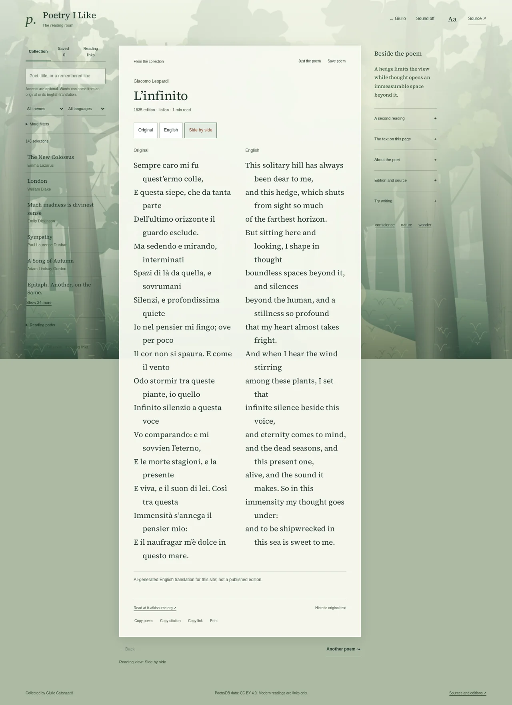

# Poetry I Like

Read 172 selected poems, open 55 linked readings and browse 2,402 historic
English poems from PoetryDB. The Concordia Discors shelf gathers 48 selections
from Poets’ Nook and the magazine’s essay on Norwid. Read Apollinaire’s
complete French original in the room. Modern texts by Montale, Sbarbaro and
others open at their published sources.

Choose a shelf and find a poet or title. The selected poems also support
search by line, language and theme. Ten reading paths include freedom,
conscience, solidarity and a route through Montale and Sbarbaro. Save a poem,
share its bookmark, or switch between an original and its available English
translation. Original pixel portraits appear beside the readings.

## Run locally

Node.js 20 or later. No package dependencies or API keys.

```sh
git clone --branch codex/poetry-paths-and-rain https://github.com/sargonxg/Poetry-I-Like.git
cd Poetry-I-Like
npm test
npm run dev
```

Open http://127.0.0.1:5175. Serve `dist/` over HTTP for archive shelves,
pixel portraits and recorded rain. The selected poems also open directly in
`dist/index.html` as a local file. A hosted copy can pair this reader with the
Baroque listening room’s local keyboard transport. The personal site uses that
integration. The standalone build includes rain and stream soundscapes.

## Read and return

The poem stays at the centre. Reading notes, writing prompts, share and print
controls open below it. Use **Aa** to adjust type, spacing, paper and focus.
Saved poems are browser-local. Export or import their IDs from reading
settings. The reader loads archive metadata on first use and text in small
shelves as you choose poems. Archive search matches poets and titles.

Choose rain, a stream or an available piano piece from **Listen while reading**.
Sound starts after Play and stops when the page is hidden. On the personal
site music continues while you choose another poem. A score link opens the
same Baroque piece in the listening room.

## Sources, translations and audit

`data/poems.json` is the canonical collection. Each full text carries an edition,
rights basis and source check. `data/source-audit-20261112.json` documents
source-text verification, excerpt corrections and held records. Broken compound
PoetryDB URLs were replaced with verified title endpoints. Three edition
variants were replaced with the exact source text; Giusti's Sant'Ambrogio is
now the complete 96-line poem. The ten additions are checked against the
Academy of American Poets, PoetryDB or Wikisource, with links and rights
information on each record.

Full texts use public-domain originals. PoetryDB collection data is CC BY 4.0;
original texts and translations have distinct rights. Modern favourites such as
Krynicki, Montale and Sbarbaro remain external references with no protected verse
stored. The Concordia shelf links to each named reading or printed excerpt, including
`Liberté` and `Frederick Douglass`. Those readings are counted separately.
The [archive manifest](data/archive/manifest.json) records the source snapshots,
licence and per-shelf hashes. The optional `scripts/import-archive.py` rebuilds
the shelves from those saved PoetryDB responses. Its checks remove duplicates
and explicitly labelled extracts. The archive is a source edition collection,
with individual editorial selection on the curated shelf.

New English translations are **AI-generated for this project** and labelled in
the reader, exports and each record. They are not established published
translations; no human editorial review is claimed. Read the original alongside
them. Source Serif 4 is by Adobe, distributed under its retained OFL licence.

## Static hosting

```sh
npm run build
```

Deploy only `dist/`. A Workers Static Assets configuration is included; it does
not activate a route, configure authentication or set a spending cap. An
owner-private copy needs whole-host Cloudflare Access configured separately.
No database, bucket, backend, subscription or scheduled work is required.

## Verification

`npm test` checks content/rights separation, multilingual minimums, translation
attribution, search, saved shelves, bookmark validation, non-repeating shuffles,
settings and emitted CSP hashes. Browser captures and their limits are recorded
in `docs/`. The following captures show this multilingual reader integrated into
the personal site in Chromium CI on November 12, 2026. The return link belongs
to that integration; the reading interface and collection are this app's build.



[Phone reading view](docs/screenshots/multilingual-mobile.webp). These are real
rendered captures, not mockups. Browser emulation does not certify physical
devices or screen-reader use. See the personal-site validation run
[43260842008](https://github.com/sargonxg/Gc-personal-site/actions/runs/43260842008)
for integrated tests; that repository is private.

## Pixel portraits and edition scope

The 32 × 34 pixel illustrations are original decorative art. The historic
archive and marked reading links use separate source records. Some Poets’ Nook
links open excerpts. The reading interface directs visitors to those pages.
