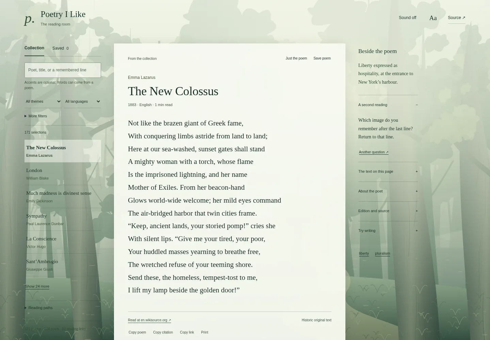

# Poetry I Like

[Mobile view](screenshots/mobile.webp)

A quiet browser reader for **121 full-text poems by 104 poets**, with 50 further
reading references. Browse by poet, theme or language; read one line at a time;
save a poem; turn on soft rain or a forest soundscape.

The room uses original forest artwork and translucent paper. There are no
accounts, analytics, model calls, external fonts or audio downloads.

## Open it

Node.js 20 or later is enough. There are no package dependencies.

~~~sh
git clone https://github.com/sargonxg/Poetry-I-Like.git
cd Poetry-I-Like
npm run build
npm run dev
~~~

Open **http://127.0.0.1:5175**. You can also open dist/index.html directly in a
browser after building: the reader, data, CSS, JavaScript and artwork are all
in that file. Sound needs a browser that supports Web Audio.

## Things to try

1. Open **The New Colossus**, then choose **liberty** to find related poems.
2. Search a poet or title, or choose a language.
3. Use **Another poem** to read a random full text from the current filtered
   shelf. **Back** returns through the poems you visited.
4. Choose **Aa → Follow one line**, then click a line or use the up/down keys
   when focus is outside a control. Adjust text size and paper tone.
5. Save poems with the heart. The saved shelf stays in this browser.
6. Open **A small exercise** to try an original writing prompt. Notes stay in
   the tab and are cleared when changing poems.
7. Turn **Sound off** on for synthesized rain. Under **Aa**, choose forest air
   or change the volume. Sound stops when you leave the tab.

Modern writers including **Krynicki, Montale and Sbarbaro** appear as source-linked
reading references. Their protected verse is not republished. The collection
also links to [Concordia Discors poetry](https://concordiadiscors.org/poetry/).

## Deploy a static copy

Upload the contents of dist/ to any static host. A Cloudflare Workers asset-only
configuration is included. It intentionally disables workers.dev and version
preview URLs; it does not create a public route or configure authentication.

~~~sh
npm run build
npx wrangler deploy
~~~

Configure your own domain/route and access policy in your Cloudflare account.
To keep a hosted room private, put the entire hostname behind Cloudflare Access
and test anonymous requests before sharing. The app itself has no login or
server. No database, storage bucket, model endpoint or scheduled job is needed.
The repository does not automatically deploy on push.

## Data and rights

Every entry in [data/poems.json](data/poems.json) keeps its source URL and a
rights record. Full texts are drawn from public-domain editions. Modern reading
references have empty lines arrays and an external source. Most of the library
is English; the language filter reflects the actual records.

PoetryDB collection data is **CC BY 4.0**. Individual original poem texts are
public domain in the cited editions; translation and copyright rules can vary
by jurisdiction. Do not replace historic originals with modern translations
without checking their rights. See [data/README.md](data/README.md) and
[data/provenance.json](data/provenance.json).

The reading questions, exercises, code and forest illustration are original to
this project. The notes are editorial invitations, not scholarly conclusions.

## Development and verification

~~~sh
npm test
npm run build
~~~

Tests cover the collection/rights boundary, combined filters, non-repeating
random selection, saved-ID validation and safe external links. There are no
remote calls in the build. The build prints the HTML hash and collection counts.
The screenshot and interaction check record, when supplied, is in docs/.

The src/ directory contains readable HTML, CSS, behavior and pure selection
functions. scripts/build.mjs embeds the canonical collection and original SVG
into the static entry. scripts/dev.mjs serves an explicit local file allowlist.

## Privacy

Saved poem IDs use localStorage on this browser only. No text is uploaded.
Reading notes remain in memory, not persistent storage. Audio is synthesized
locally after a click and stops on page hide. External source links are ordinary
links that open in another tab without access to the reader window.

Code and original artwork: [MIT](LICENSE). Collection data: CC BY 4.0 with source
attribution. The MIT license does not replace the separate rights of poem texts.
