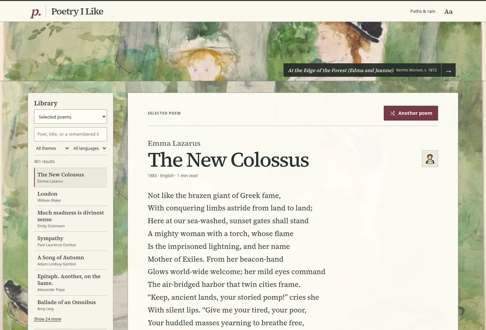

# Poetry I Like

Read 401 complete poems by 139 poets in English, Italian, French and Polish. Start with Emma Lazarus’s *The New Colossus*, search for a line you remember or choose **Another poem**. The shuffle follows the current shelf and filters, drawing complete poems without a repeat until the selection runs out. [Open the reading room](https://giulio-catanzariti.giuliocatanzariti.workers.dev/poetry)



## On the shelves

| Shelf | Contents |
| --- | --- |
| Selected poems | 240 English, 58 Italian, 57 French and 46 Polish originals. Search by poet, title, theme or a remembered line. |
| Concordia Discors | 48 selections and readings associated with the magazine, including its essay on Norwid. Each record distinguishes a local text, a poem at its source or a published excerpt. |
| Modern readings | Publisher and magazine links for Krynicki, Montale, Sbarbaro and others. The catalogue has 55 external readings across its shelves. |
| Historic archive | 2,401 further English-language entries from the PoetryDB snapshot. Search by poet or title. Verse downloads as a reader opens a shelf. |
| Saved poems | A personal shelf stored in the browser. Reading settings can export and import its IDs. |

The ten reading paths include freedom, solidarity, conscience and Italian verse. **Paths & rain** opens the path selector and sound controls. Rain starts on request and stops when the tab becomes hidden. Four soundscapes share a volume control. **Aa** changes the paper, type size, line spacing or reading focus. **Just the poem** leaves the reading desk on its own. [Phone reading view](docs/screenshots/gallery-phone.webp)

Read originals beside an available English translation. Leopardi’s *L’infinito* includes Frederick Townsend’s 1887 translation, with its own line focus and edition link. Other supplied translations carry an explicit AI-generated credit. A poem’s source, translator and rights remain attached to its record. [Read *L’infinito*](https://giulio-catanzariti.giuliocatanzariti.workers.dev/poetry#poem=leopardi-infinito)

## Run locally

Use Node.js 20 or newer. The build uses Node’s standard library.

```sh
git clone --branch codex/poetry-paths-and-rain https://github.com/sargonxg/Poetry-I-Like.git
cd Poetry-I-Like
npm test
npm run dev
```

Open `http://127.0.0.1:5175/`. The development server serves the complete static build, including paintings, the historic archive and rain recordings. Set `PORT` to choose another port. The self-contained `dist/index.html` also opens selected texts offline in modern browsers with gzip decompression support. HTTP hosting enables the full archive and recorded ambience.

A poem has a shareable fragment such as `#poem=lazarus-new-colossus`. Add `&line=3` to open the fourth source line in focus mode. `?path=liberty` starts a reading path. `?pick=random` opens a complete selected poem. Existing poem and path links take priority over the random entry point. The former PoetryDB archive link to *Ozymandias* still opens the same poem and preserves saved copies.

## Editions, images and sound

The canonical collection records each poem’s source, edition and rights. In this edition, 227 complete additions were checked across 17 historical source editions, alongside two poems carried forward from the personal site. The archive and selected shelf each have a separate manifest. Modern reading records link to authorised source pages and hold editorial metadata. Translations are attached to the original poem and counted once. [Canonical collection](data/poems.json) · [November source audit](data/source-audit-20261112.json) · [Added editions and text hashes](data/editions-20261124.json) · [Provenance](data/provenance.json) · [Archive manifest](data/archive/manifest.json)

The painting arrow rotates Berthe Morisot’s *At the Edge of the Forest (Edma and Jeanne)*, Claude Monet’s *The Japanese Footbridge* and Alfred Sisley’s *First Snow at Veneux-Nadon*. The National Gallery of Art releases the three images into the public domain. The room links each painting to its museum record and lists the credit line and reuse terms under **Paintings**. Phone and desktop crops come from the same image. [Painting sources](assets/gallery/works.json)

PoetryDB’s collection data uses CC BY 4.0. Historic originals retain their individual rights basis. Rain recordings retain their contributor credits and licences. Adobe’s Source Serif 4 uses the SIL Open Font License. [PoetryDB](https://poetrydb.org/) · [Sound credits](assets/ambience/provenance.json) · [Font licence](assets/fonts/SOURCE-SERIF-4-OFL.txt)

## Build and verification

`npm run build` writes the deployable site to `dist/`. The build emits CSP hashes for the app script and stylesheet. Standalone HTML contains the compressed selected collection. A host can point the `poetry-data` JSON element at a same-origin catalogue and provide separate edition shelves. Only the active painting size downloads. The included Workers static-assets configuration leaves domain and access settings to the host.

`npm test` checks rights, translations, collection and archive integrity, shuffling, bookmarks, migrated IDs, museum image assets and the emitted bundle. Desktop and narrow-screen Chromium checks covered reading and sharing links, filtered shuffle, painting credits, the published translation, recorded rain, forced colours and focus navigation. The screenshots above are from the runnable app.
